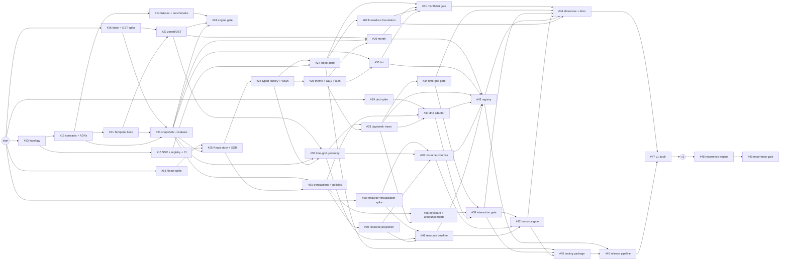

# Moltenship Time — Implementation Plan

Time is planned as a dependency-driven program, not a sequence of oversized feature branches. The GitHub roadmap uses one tracker, phase epics, independently mergeable tasks, native sub-issues, and native `blocked by` relationships. Five risk/topology tasks can start immediately; every later task becomes merge-ready only when its actual contract dependencies close.

> **Status:** Active
> **Roadmap:** [GitHub issue #1](https://github.com/Moltenship/time/issues/1)
> **Normative design:** [architecture.md](./architecture.md)
> **Planning unit:** one issue → one branch/worktree → one focused PR
> **Scheduling policy:** dependencies and priority are explicit; calendar dates wait for capacity data
> **v1 scope:** phases 0–7; recurrence is intentionally post-1.0

## 1. What was created

- 1 roadmap tracker: [#1](https://github.com/Moltenship/time/issues/1)
- 9 phase epics, each attached to the tracker as a native sub-issue
- 38 independently mergeable implementation tasks attached to their phase epics
- 33 tasks with native GitHub `blocked by` relationships
- 5 deliberately unblocked kickoff tasks
- 5 outcome milestones
- labels for `type`, `area`, `priority`, and `size`

GitHub is the live execution state. This document is the readable map and operating agreement. When scope or dependencies change, update the issue relationship and this file in the same PR.

## 2. Current ready lanes

The foundation, engine, and headless React slices are complete. These issues have no open blockers
and can start from the current baseline:

| Lane                         | Ready issue                                         | Purpose                                                                | Primary ownership while parallel                     |
| ---------------------------- | --------------------------------------------------- | ---------------------------------------------------------------------- | ---------------------------------------------------- |
| A — docs platform            | [#68](https://github.com/Moltenship/time/issues/68) | Establish Fumadocs before view examples and public guides multiply     | `apps/showcase`, `apps/website`, docs content/config |
| B — view primitives          | [#28](https://github.com/Moltenship/time/issues/28) | Establish shadcn tokens, accessibility, and typed messages             | Shared registry primitives and theme source          |
| C — time-grid engine         | [#32](https://github.com/Moltenship/time/issues/32) | Build pure wall-time geometry and business-interval strategy           | Core time-grid strategy, projection, and tests       |
| D — semantic transactions    | [#35](https://github.com/Moltenship/time/issues/35) | Build the framework-independent change and optimistic-overlay contract | Core transaction and policy modules                  |

The Fumadocs task is intentionally in phase 3, not phase 7. It installs the content, navigation,
search, and production-build boundary while the public surface is still small. View-owning issues
then add consumer-equivalent examples incrementally; phase 7 completes the content and labs rather
than migrating a mature standalone showcase into documentation.

## 3. Outcome milestones

| Milestone                       | Epics                                                                                                                                                     | Product outcome                                                                                    | Exit signal                                                         |
| ------------------------------- | --------------------------------------------------------------------------------------------------------------------------------------------------------- | -------------------------------------------------------------------------------------------------- | ------------------------------------------------------------------- |
| `0.1 — Foundation & contracts`  | [#9](https://github.com/Moltenship/time/issues/9), [#11](https://github.com/Moltenship/time/issues/11), [#3](https://github.com/Moltenship/time/issues/3) | Package graph, architecture contracts, risk proof, Temporal/index engines, React/custom-view spine | Epics 0–2 and gates #24/#27 close with performance and SSR evidence |
| `0.2 — Read-only calendar`      | [#6](https://github.com/Moltenship/time/issues/6), [#4](https://github.com/Moltenship/time/issues/4)                                                      | Fumadocs foundation plus theme/a11y, month, list, day, and week views                               | Gates #31 and #34 close in documentation, clean Vite, and SSR consumers |
| `0.3 — Interaction & resources` | [#8](https://github.com/Moltenship/time/issues/8), [#10](https://github.com/Moltenship/time/issues/10)                                                    | Semantic transactions, keyboard and dnd input, resource columns, resource timeline                 | Gates #38 and #42 close at target density and browser coverage      |
| `1.0 — Public release`          | [#5](https://github.com/Moltenship/time/issues/5)                                                                                                         | Registry, showcase, testing package, release artifacts, compatibility proof                        | Release audit #47 closes with no open p0/p1 release issue           |
| `Post-1.0 — Recurrence`         | [#2](https://github.com/Moltenship/time/issues/2)                                                                                                         | Range-bounded recurrence, exceptions, detached occurrences                                         | Gate #49 closes without breaking base event/transaction contracts   |

No dates are invented here. Add milestone dates only after maintainer capacity, desired release cadence, and concurrent-worker count are known. Sizes communicate relative merge risk, not elapsed time.

## 4. Execution graph

This diagram shows the critical merges and parallel joins. The issue inventory in section 7 contains every exact blocker.



## 5. Workstreams and merge ownership

The phases describe product maturity. Workstreams describe who can work without colliding.

| Workstream         | Core sequence               | Common files/directories                                     | Coordination rule                                               |
| ------------------ | --------------------------- | ------------------------------------------------------------ | --------------------------------------------------------------- |
| Foundation/tooling | #13 → #12 → #14/#15         | root manifests, `tools/`, `benchmarks/`, `docs/adr/`, CI     | Merge topology first; downstream branches rebase after it       |
| Temporal/core data | #16 → #21 → #22/#23 → #24   | `calendar-temporal`, snapshot/index modules, core benchmarks | Public contract changes require #12 and an ADR                  |
| React integration  | #18 → #25 → #26 → #27       | `calendar-react`, SSR fixture, React harness                 | No default view markup and no exported Jotai types              |
| Source views       | #28 → #29/#30 and #32 → #33 | `registry/`, view strategies/projections/layouts             | Strategy/layout stays pure; renderer source remains replaceable |
| Interaction        | #19 → #35 → #36/#37 → #38   | transaction/policy core, `calendar-dnd`, interaction tests   | dnd-kit never leaks into semantic callbacks                     |
| Resources          | #20 → #39 → #40/#41 → #42   | resource projections and view-specific adapters              | Columns and timeline may proceed in parallel after #39          |
| Product/release    | #68 → #44 and #43/#45 → #44/#46 → #47 | `apps/showcase`, docs content, registry build, testing package, release tooling | Establish Fumadocs in phase 3; showcase examples use public APIs only |

When two tasks touch the same public contract, split the contract change into the earlier blocking issue instead of resolving it through parallel incompatible implementations.

## 6. Critical path and delivery slices

The longest dependency chain is not the only useful order. Deliver in demonstrable vertical slices:

1. **Foundation slice:** #13, #12, #14, #15 plus spikes #16/#18/#19/#20.
2. **Engine slice:** #21–#24 proves time/index correctness and target performance.
3. **Headless React slice:** #25–#27 proves controlled state, SSR, typed composition, and custom views.
4. **First visible slice:** #68 and #28–#31 establish Fumadocs, then install month/list into clean consumers and the public docs surface.
5. **Time-grid slice:** #32–#34 adds useful day/week scheduling with DST/business hours.
6. **Interaction slice:** #35–#38 adds semantic create/move/resize through all input methods.
7. **Resource slice:** #39–#42 adds both virtualized resource views.
8. **Release slice:** #43–#47 publishes the registry/showcase/testing story and audits v1.

The most likely v1 critical spine is:

```text
#13 → #12 → #21 → #23 → #25 → #26 → #28 → #32 → #33
  → #35 → #37 → #38 → #39 → #40/#41 → #42 → #43 → #44/#46 → #47
```

The documentation spine is `#27 → #68 → #31 → #44`: platform work starts from the stable public
React contract, phase 3 proves the first visible examples, and phase 7 fills the established surface
with the complete view, interaction, resource, registry, and evidence catalog.

The spike and quality branches join that spine as hard gates. Closing feature code without its gate issue does not complete a milestone.

## 7. Complete issue inventory

### Phase 0 — contracts, harnesses, and risk retirement ([epic #9](https://github.com/Moltenship/time/issues/9))

| Issue                                               | Work package                                   | Size | Blocked by |
| --------------------------------------------------- | ---------------------------------------------- | ---- | ---------- |
| [#13](https://github.com/Moltenship/time/issues/13) | Target monorepo topology and package skeletons | L    | —          |
| [#12](https://github.com/Moltenship/time/issues/12) | Canonical contracts and ADRs                   | L    | #13        |
| [#14](https://github.com/Moltenship/time/issues/14) | Deterministic fixtures and benchmark harness   | M    | #13, #12   |
| [#15](https://github.com/Moltenship/time/issues/15) | SSR fixture, registry smoke, and CI gates      | M    | #13        |
| [#18](https://github.com/Moltenship/time/issues/18) | Spike: controlled store and typed factory      | M    | —          |
| [#16](https://github.com/Moltenship/time/issues/16) | Spike: interval index and DST geometry         | M    | —          |
| [#19](https://github.com/Moltenship/time/issues/19) | Spike: semantic dnd-kit adapter                | M    | —          |
| [#20](https://github.com/Moltenship/time/issues/20) | Spike: two-axis resource virtualization        | M    | —          |

### Phase 1 — Temporal utilities and indexed snapshots ([epic #11](https://github.com/Moltenship/time/issues/11))

| Issue                                               | Work package                               | Size | Blocked by    |
| --------------------------------------------------- | ------------------------------------------ | ---- | ------------- |
| [#21](https://github.com/Moltenship/time/issues/21) | Type-specific Temporal intervals and grids | L    | #12           |
| [#22](https://github.com/Moltenship/time/issues/22) | Zoned-day, slots, and DST utilities        | L    | #21, #16      |
| [#23](https://github.com/Moltenship/time/issues/23) | Normalization, snapshots, and indexes      | L    | #12, #16, #21 |
| [#24](https://github.com/Moltenship/time/issues/24) | Gate: engine correctness and performance   | M    | #14, #22, #23 |

### Phase 2 — React provider and custom-view spine ([epic #3](https://github.com/Moltenship/time/issues/3))

| Issue                                               | Work package                                          | Size | Blocked by    |
| --------------------------------------------------- | ----------------------------------------------------- | ---- | ------------- |
| [#25](https://github.com/Moltenship/time/issues/25) | Per-instance store, controlled slices, SSR snapshots  | L    | #18, #23, #15 |
| [#26](https://github.com/Moltenship/time/issues/26) | Typed factory, compound context, custom-view registry | L    | #25           |
| [#27](https://github.com/Moltenship/time/issues/27) | Gate: isolation, custom-view, and SSR contracts       | M    | #26, #15      |

### Phase 3 — month and list views ([epic #6](https://github.com/Moltenship/time/issues/6))

| Issue                                               | Work package                                     | Size | Blocked by         |
| --------------------------------------------------- | ------------------------------------------------ | ---- | ------------------ |
| [#68](https://github.com/Moltenship/time/issues/68) | Fumadocs documentation platform and content pipeline | M | #27                |
| [#28](https://github.com/Moltenship/time/issues/28) | shadcn theme, accessibility, and i18n primitives | M    | #26, #15           |
| [#29](https://github.com/Moltenship/time/issues/29) | Month strategy, layout, and registry view        | L    | #22, #23, #26, #28 |
| [#30](https://github.com/Moltenship/time/issues/30) | Virtualized list/agenda strategy and view        | L    | #23, #26, #28      |
| [#31](https://github.com/Moltenship/time/issues/31) | Gate: integrated read-only month/list slice      | M    | #27, #29, #30, #68 |

### Phase 4 — day and week time grid ([epic #4](https://github.com/Moltenship/time/issues/4))

| Issue                                               | Work package                                               | Size | Blocked by    |
| --------------------------------------------------- | ---------------------------------------------------------- | ---- | ------------- |
| [#32](https://github.com/Moltenship/time/issues/32) | Time-grid strategy, wall-time geometry, business intervals | L    | #22, #23, #26 |
| [#33](https://github.com/Moltenship/time/issues/33) | Timed overlaps, all-day lanes, day/week source             | L    | #32, #28      |
| [#34](https://github.com/Moltenship/time/issues/34) | Gate: DST, performance, SSR, and browser behavior          | M    | #14, #27, #33 |

### Phase 5 — semantic interaction and dnd-kit ([epic #8](https://github.com/Moltenship/time/issues/8))

| Issue                                               | Work package                                        | Size | Blocked by    |
| --------------------------------------------------- | --------------------------------------------------- | ---- | ------------- |
| [#35](https://github.com/Moltenship/time/issues/35) | Transactions, policy pipeline, optimistic overlay   | L    | #25, #23      |
| [#36](https://github.com/Moltenship/time/issues/36) | Selection, keyboard/explicit actions, announcements | M    | #35, #33, #28 |
| [#37](https://github.com/Moltenship/time/issues/37) | Optional dnd-kit pointer/touch/resize adapter       | L    | #19, #35, #33 |
| [#38](https://github.com/Moltenship/time/issues/38) | Gate: parity, races, accessibility, frame budgets   | M    | #36, #37, #34 |

### Phase 6 — resource views ([epic #10](https://github.com/Moltenship/time/issues/10))

| Issue                                               | Work package                                     | Size | Blocked by         |
| --------------------------------------------------- | ------------------------------------------------ | ---- | ------------------ |
| [#39](https://github.com/Moltenship/time/issues/39) | Resource hierarchy and multi-resource projection | L    | #23, #26, #35      |
| [#40](https://github.com/Moltenship/time/issues/40) | Virtualized resource-columns day view            | L    | #20, #32, #39, #28 |
| [#41](https://github.com/Moltenship/time/issues/41) | Two-axis resource timeline                       | L    | #20, #32, #39, #28 |
| [#42](https://github.com/Moltenship/time/issues/42) | Gate: scale, interaction, RTL, and focus         | M    | #40, #41, #38      |

### Phase 7 — registry, showcase, and v1 hardening ([epic #5](https://github.com/Moltenship/time/issues/5))

| Issue                                               | Work package                                            | Size | Blocked by                   |
| --------------------------------------------------- | ------------------------------------------------------- | ---- | ---------------------------- |
| [#43](https://github.com/Moltenship/time/issues/43) | Granular/full shadcn registry and compatibility         | L    | #29, #30, #33, #37, #40, #41 |
| [#44](https://github.com/Moltenship/time/issues/44) | Complete Fumadocs showcase, labs, and documentation | L  | #31, #34, #38, #42, #43, #68 |
| [#45](https://github.com/Moltenship/time/issues/45) | Public testing package and consumer fixtures            | M    | #27, #38, #42                |
| [#46](https://github.com/Moltenship/time/issues/46) | Release automation, browser matrix, provenance, budgets | L    | #43, #45                     |
| [#47](https://github.com/Moltenship/time/issues/47) | Gate: v1 architecture and release audit                 | M    | #44, #46                     |

### Phase 8 — recurrence, after v1 ([epic #2](https://github.com/Moltenship/time/issues/2))

| Issue                                               | Work package                                       | Size | Blocked by |
| --------------------------------------------------- | -------------------------------------------------- | ---- | ---------- |
| [#48](https://github.com/Moltenship/time/issues/48) | Recurrence contracts and bounded expansion         | L    | #47        |
| [#49](https://github.com/Moltenship/time/issues/49) | Gate: exceptions, detached events, DST/performance | L    | #48        |

## 8. Definition of ready

An implementation issue is ready to merge toward only when:

- GitHub shows no open native blocker.
- The parent epic and milestone are correct.
- Acceptance criteria describe observable behavior, not implementation activity.
- Upstream public contracts are merged and imported through package entry points.
- Required fixtures/harnesses exist or are part of the issue scope.
- The branch has a clear file-ownership boundary against other active work.
- Open architecture uncertainty is assigned to a spike or ADR, not hidden inside feature work.

A blocked issue may be researched in parallel, but its production PR should not establish a competing version of an unsettled upstream contract.

## 9. Definition of done

Every task PR must:

- close exactly one primary task issue with `Closes #…`;
- satisfy and check the issue acceptance criteria;
- include focused tests and the relevant production-build checks;
- attach benchmark, SSR, browser, accessibility, or visual evidence requested by the issue;
- preserve every applicable architecture invariant;
- avoid new deep imports, god files, boolean-prop matrices, and frame-time full scans;
- update public documentation and API reports when a public contract changes;
- update this plan and GitHub blockers together when sequencing changes;
- leave no unexplained test skip, threshold relaxation, or follow-up TODO required for the issue's outcome.

Phase gate issues are evidence/audit work packages, not feature catch-alls. They close only after all upstream implementation evidence is reproducible.

## 10. Branch, PR, and merge policy

1. Use one branch/worktree per issue, for example `chore/13-package-topology` or `spike/18-react-store`.
2. Rebase or merge the latest `main` after every native blocker closes.
3. Prefer contract and pure-engine PRs before React/source PRs that consume them.
4. Keep generated registry output and its source change in the same PR.
5. Use stacked PRs only when GitHub blockers express the same stack; never hide an ordering dependency in prose.
6. Merge a gate issue last within its delivery slice.
7. Close an epic only after every native sub-issue and its gate are closed.
8. Recurrence work starts after #47; it does not delay v1.

The repository PR template asks for the issue, contract impact, evidence, architecture checks, and rollout risk so reviewers can decide from one page.

## 11. Required commands and evidence

All implementation work keeps the Vite+ baseline:

```sh
vp install
vp check
vp test
vp run -r build
```

Issues add focused tasks such as benchmark, SSR, registry, package-size, API-report, and browser checks as those harnesses are created. Those checks must become named Vite+ tasks; a one-off local command is not sufficient release evidence.

Evidence belongs as close as possible to the claim:

- unit/property/golden output for pure engines;
- API reports and consumer type fixtures for public contracts;
- render/commit/DOM/frame traces for performance;
- SSR render/hydrate output for framework compatibility;
- Playwright artifacts for browser and interaction claims;
- axe output plus manual screen-reader scripts for accessibility;
- registry schema/install/diff output for source distribution;
- size/provenance/clean-install output for release artifacts.

## 12. Change-control rules

- `architecture.md` remains normative for product and package boundaries.
- This file remains normative for execution order.
- GitHub's native parent and blocker relationships remain normative for live status.
- A public-contract reversal requires an ADR and updates to affected blockers.
- A performance threshold may change only with recorded hardware/traces and an ADR.
- New scope enters as a child of the nearest epic and must identify what it blocks.
- Nice-to-have work that does not block a milestone receives `priority: p2`; it does not silently enter the critical path.
- Assign due dates only after capacity planning; do not convert T-shirt size directly into calendar promises.
